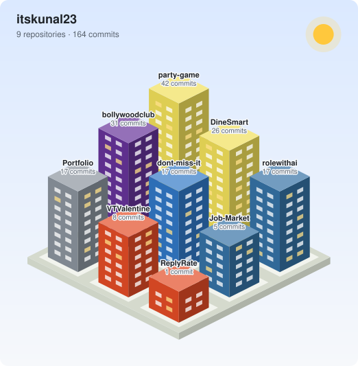

# Kunal Goenka

**AI engineer building agent workflows, RAG systems and MCP integrations.** OMSCS (AI) at Georgia Tech · Washington, DC

[Portfolio](https://kunal-goenka-portfolio.vercel.app/) · [LinkedIn](https://www.linkedin.com/in/kunalgoenka23/) · [Email](mailto:kunalgoenka23@gmail.com)

## Projects

| Project | What it is | Stack |
|:---|:---|:---|
| **[Portfolio](https://github.com/itskunal23/Portfolio)** ([live](https://kunal-goenka-portfolio.vercel.app/)) | My personal site and project showcase | Astro, TypeScript, Tailwind |
| **[RoleWithAI](https://github.com/itskunal23/rolewithai)** | Resume parsing and career dashboard | Python, FastAPI, Next.js |
| **[Job-Market](https://github.com/itskunal23/Job-Market)** | Ghost-job risk scoring for job listings, with a browser extension | Next.js, Supabase, Gemini |
| **[dont-miss-it](https://github.com/itskunal23/dont-miss-it)** | Turns a brain dump into one task at a time | Next.js, TypeScript, Supabase |
| **[ReplyRate](https://github.com/itskunal23/ReplyRate)** | Idea-stage tool showing which employers reply to applicants. Clickable prototype with example data | HTML prototype |

## My GitHub City

Each building is a repository; it grows taller with more commits. Redrawn daily.

<picture>
  <source media="(prefers-color-scheme: dark)" srcset="assets/city-dark.svg">
  
</picture>
